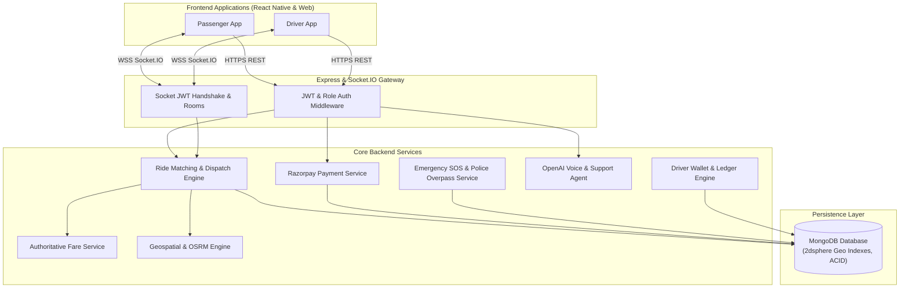

# GoRide - Complete Project Architecture, Workflow & Tech Stack Documentation

> **Project Name:** GoRide (Cab & Mobility Booking Platform)  
> **Type:** Full-Stack Real-Time Mobile & Web Application (Passenger + Driver)  
> **Author/Maintainer:** GoRide Team  
> **Last Updated:** October 2026  

---

## 1. Executive Summary

**GoRide** is a production-ready, full-stack, real-time ride-hailing and mobility platform built to support passengers and drivers with seamless trip matching, live geospatial GPS navigation, AI-driven voice booking, robust security & SOS safety shields, and automated online payments powered by **Razorpay**.

The platform is architected with a decoupled **React Native (Expo)** cross-platform client (Android, iOS, Web) and a high-performance **Node.js / Express / Socket.io / MongoDB** backend.

---

## 2. Technology Stack

### 2.1 Frontend (Mobile App & Web)
| Category | Technology / Library | Purpose |
| :--- | :--- | :--- |
| **Framework** | **React Native (0.86.3) & Expo SDK 57** | Cross-platform runtime targeting Android, iOS, and Web |
| **Language** | **TypeScript 6.0** | Strict type safety, clean data contracts, and zero runtime interface crashes |
| **Navigation** | `@react-navigation/native-stack` & `@react-navigation/bottom-tabs` (v7) | Native stack navigation, tab bars, deep linking |
| **State Management** | **React Context API** (`AuthContext`, `RideContext`, `NotificationContext`) | Modular global state, live ride state synchronization |
| **Maps & Routing** | `react-native-maps` & OpenStreetMap / Leaflet (Web) | Native Google/Apple Maps with custom marker rendering and polyline route drawing |
| **Location Services** | `expo-location` | High-accuracy foreground and background GPS polling |
| **Real-Time Client** | `socket.io-client` (v4.8) | Event-driven WebSocket connection with auto-reconnection and room subscriptions |
| **Payment Gateway** | `react-native-razorpay` + Razorpay Web JS Modal | Cross-platform Razorpay checkout (UPI, Cards, NetBanking, Wallets) |
| **AI Voice & Speech** | `expo-speech` & `expo-speech-recognition` | Native speech-to-text recognition and text-to-speech feedback |
| **UI & Animations** | `react-native-reanimated` (v4.5), `@gorhom/bottom-sheet`, `expo-linear-gradient` | 60 FPS gesture-driven bottom sheets, radar animations, gradients |
| **Networking** | `axios` (v1.19) | HTTP client with automatic JWT token attachment and interceptors |
| **Storage** | `@react-native-async-storage/async-storage` | Local persistent storage for auth tokens, cached preferences, user session |

---

### 2.2 Backend (Server, Real-Time & Security)
| Category | Technology / Library | Purpose |
| :--- | :--- | :--- |
| **Runtime & Server** | **Node.js (>=18.0) & Express.js (4.19)** | RESTful API server and request routing |
| **Real-Time Engine** | **Socket.io (4.7)** | Bi-directional WebSocket communication for live ride dispatch and GPS updates |
| **Database & ODM** | **MongoDB & Mongoose (8.4)** | NoSQL document database with geospatial `2dsphere` indexes and ACID transactions |
| **Validation** | **Zod (3.23)** | Server-side runtime schema validation for requests and query parameters |
| **Authentication** | `jsonwebtoken` (JWT) + `bcryptjs` + `cookie-parser` | Stateless Access Tokens, Stateful Refresh Tokens with rotation, salted password hashing |
| **Security Shields** | `helmet`, `cors`, `express-rate-limit`, `express-mongo-sanitize` | Protection against XSS, CORS exploits, Brute Force, and NoSQL Injection |
| **Payment SDK** | `razorpay` (v2.9) | Server-side order creation (`order_...`) and HMAC-SHA256 signature verification |
| **Email Service** | `nodemailer` (v10.0) | Automated transactional emails for OTPs, ride invoices, emergency SOS alerts |
| **Logging** | `pino` (9.1) & `pino-http` | High-throughput JSON structured logging with minimal overhead |
| **Testing** | `jest` (29.7), `supertest` (7.0), `mongodb-memory-server` (9.2) | Full integration test coverage for auth, ride matching, payments, and race conditions |

---

### 2.3 Third-Party APIs & Services
1. **Razorpay Payments API:** End-to-end Indian payment processing (UPI, cards, net banking).
2. **OpenStreetMap Nominatim:** Forward geocoding (place search) and reverse geocoding (GPS to human address).
3. **OSRM (Open Source Routing Machine):** Road-network routing, driving distance calculation, travel duration estimation, and polyline coordinates.
4. **OpenStreetMap Overpass API:** Real-time spatial discovery of nearby active police stations within a 5-10 km radius for emergency safety.
5. **OpenAI GPT-4o-mini:** Natural Language Processing (NLP) for AI Voice Ride Booking and 24/7 AI Customer Support Chatbot.

---

## 3. End-to-End System Architecture



---

## 4. Complete Passenger Workflow

```
[1. Welcome / Auth]
       │
       ▼
[2. Home Screen] ──(Current GPS & Nearby Drivers Rendered)
       │
       ├─────────────────────────┬─────────────────────────┐
       ▼                         ▼                         ▼
[3A. Manual Search]     [3B. AI Voice Booking]    [3C. Tap on Map]
(Nominatim Geocoding)   (OpenAI Speech Parsing)   (Reverse Geocoding)
       │                         │                         │
       └─────────────────────────┴─────────────────────────┘
                                 │
                                 ▼
                     [4. Fare Estimate Screen]
                     • Vehicle Selection (Bike, Auto, Car, SUV)
                     • OSRM Distance & Duration
                     • Cash vs Online (Razorpay)
                     • Safety Option (Prefer Female Driver)
                                 │
                                 ▼
                    [5. Searching Driver Screen]
                    • Socket broadcast: driver:new_request
                    • 60s matching countdown radar
                                 │
                                 ▼
                     [6. Driver Assigned Screen]
                     • Driver info, vehicle plate, photo
                     • Live GPS tracking of driver arriving
                     • Secret 4-digit Cryptographic Start OTP
                                 │
                                 ▼
                      [7. Driver Arrived & OTP]
                      • Passenger shares Start OTP with Driver
                      • Backend verifies cryptographic hash
                                 │
                                 ▼
                      [8. Active Ride in Progress]
                      • Live polyline route tracking
                      • Emergency SOS Swipe Button active
                                 │
                                 ▼
                      [9. Ride Completed & Payment]
                      • Online: Razorpay checkout (UPI / Card)
                      • Cash: Direct settlement with driver
                                 │
                                 ▼
                      [10. Rating & Review Screen]
                      • 1 - 5 stars, review tags, comment
```

### Detailed Passenger Steps:
1. **Onboarding & Registration:**
   - Passenger creates an account with email, phone, name, and password.
   - Saves emergency contacts (name, phone number, relationship) for the SOS shield.
2. **Selecting Destination:**
   - **Manual Mode:** Autocomplete place search via OpenStreetMap Nominatim.
   - **Voice Booking Mode:** Passenger speaks in Hindi, English, or Hinglish ("Bhaiya mujhe Hazratganj market jana hai bike se"). OpenAI GPT-4o-mini extracts pickup, destination, and vehicle type automatically.
3. **Fare Review & Confirmation:**
   - Server computes authoritative fare based on base fare, distance (km), duration (min), vehicle category, and surge multiplier.
   - Passenger chooses payment method: Cash or Razorpay Online.
4. **Driver Matching:**
   - Ride status set to `SEARCHING_DRIVER`.
   - Backend scans a 5–10 km radius for available, online drivers of that vehicle type and broadcasts the invitation.
5. **Driver Acceptance & Arrival:**
   - Once a driver accepts, passenger receives `ride:driver_assigned` event.
   - Passenger screen displays driver profile, rating, vehicle make/model/number, and live driver GPS updates.
   - Passenger is given a **4-digit Start OTP**.
6. **Ride Commencement & Active Journey:**
   - Driver inputs OTP; once verified by the server, status changes to `RIDE_STARTED`.
   - Real-time navigation tracks movement toward the drop-off location.
   - **Safety / SOS:** Passenger can swipe the in-app SOS button at any moment to trigger instant emergency dispatch.
7. **Drop-Off, Payment & Rating:**
   - Once the driver reaches the drop point and marks the ride complete, the passenger is prompted to pay via Razorpay (if online) or confirm cash.
   - Passenger rates the driver (1 to 5 stars) and leaves feedback.

---

## 5. Complete Driver Workflow

```
[1. Driver Registration & KYC]
(License, Vehicle Model, Plate No, Vehicle Type)
       │
       ▼
[2. Driver Home Screen]
• Toggle "Go Online / Go Offline"
• Today's Earnings, Trips, Acceptance Rate
       │
       ▼ (While Online)
[3. Real-Time Location Streaming]
• Sends GPS updates via socket: driver:location_update
• MongoDB 2dsphere index keeps driver visible on spatial map
       │
       ▼
[4. Incoming Ride Request Card]
• Audio alert + 20-second countdown timer
• Shows Pickup address, Drop destination, Distance & Fare
       │
       ├─────────────────────────┬─────────────────────────┐
       ▼                         ▼                         ▼
   [Accept]                  [Reject]                  [Timeout]
(Atomic DB Lock)      (Excluded from ride)     (Auto-assigned next)
       │
       ▼ (If Accepted)
[5. Pickup Route Navigation]
• Route navigation to Passenger's pickup spot
• One-tap phone call / in-app communication
• Driver taps "Arrived at Pickup" (Status: DRIVER_ARRIVED)
       │
       ▼
[6. OTP Verification & Trip Start]
• Driver asks passenger for 4-digit OTP
• Driver enters OTP in modal -> POST /api/rides/:id/start
• Validated against cryptographic hash
       │
       ▼
[7. Ride in Progress Navigation]
• Live GPS navigation to drop-off point
• Status: RIDE_STARTED
       │
       ▼
[8. Ride Completion & Payment Collection]
• Driver reaches drop point -> taps "Complete Ride"
• Cash: Collects exact amount displayed in PaymentCollectModal
• Online: Passenger completes Razorpay transaction
       │
       ▼
[9. Instant Wallet Credit]
• Fare split: Platform commission deducted
• Net earning credited to Driver Wallet Ledger
• Payout to Bank Account / UPI ID via Withdrawal Request
```

### Detailed Driver Steps:
1. **Onboarding & Verification:**
   - Driver registers vehicle details: Category (`bike`, `auto`, `car`, `suv`), license plate number, RC, driving license number, and vehicle color.
2. **Duty Toggle & Location Beacon:**
   - Driver turns switch **Online**.
   - Driver app emits periodic GPS updates (`driver:location_update`) via WebSockets to keep spatial indexes updated.
3. **Dispatch & Acceptance:**
   - When a ride is requested nearby, driver receives a high-priority request card with audio alert.
   - Card displays pickup distance, destination address, estimated fare, and a 20-second countdown.
   - Upon tapping **Accept**, an atomic database transaction secures the ride, preventing race conditions with other drivers.
4. **Pickup & OTP Verification:**
   - Driver follows route to pickup location and clicks "Arrived at Pickup".
   - Driver requests the secret 4-digit OTP from passenger and enters it into the app.
   - Trip is unlocked only when the server verifies the OTP hash.
5. **Drop-Off & Payment Settlement:**
   - At destination, driver marks "Complete Ride".
   - If Cash: In-app modal shows exact cash to collect, and driver confirms receipt.
   - If Online: Passenger pays via Razorpay; driver sees instant status update.
6. **Earnings, Wallet & Payouts:**
   - Net earnings are credited immediately to the driver's internal wallet.
   - Driver can view daily/weekly earnings charts, link UPI ID or bank account details, and request withdrawals.

---

## 6. Key Features Breakdown

### 6.1 Passenger Features
* **Multi-Vehicle Support:** Bike, Auto, Economy Car, Premium SUV with real-time fare estimates.
* **AI Voice Booking:** Voice-to-ride parsing in Hindi, English, and Hinglish via OpenAI.
* **Accurate GPS & Routing:** Live driver tracking, turn-by-turn route line, and dynamic ETA calculation.
* **Cryptographic Start OTP:** Eliminates wrong-passenger pickups and ensures verifiable trip starts.
* **Multiple Payment Options:** Seamless Razorpay payment gateway (UPI Intent, Google Pay, PhonePe, Cards, NetBanking) and Cash.
* **Safety & SOS Shield:**
  * Swipe-to-trigger emergency modal.
  * Instant SMS / Email alerts to parents and emergency contacts containing live tracking URLs.
  * Automated detection of nearest police stations via OpenStreetMap Overpass API.
  * Direct one-tap speed dial to Indian helplines: `112` (National), `100` (Police), `1091` (Women Safety).
* **Multi-Stop Rides:** Supports intermediate waypoints.
* **Ride History & Invoices:** Comprehensive past ride logs with downloadable receipts and route histories.
* **24/7 AI Customer Support:** Built-in AI chat assistant for queries regarding fares, lost items, and refunds.

### 6.2 Driver Features
* **Simple Online/Offline Toggle:** Full flexibility to control working hours.
* **Audible Trip Requests:** 20-second countdown request cards with pickup distance and guaranteed fare display.
* **Race-Condition Safe Acceptance:** Atomic MongoDB locking ensures driver never loses an accepted trip unexpectedly.
* **In-App Turn-by-Turn Navigation:** Live OSRM route guidance to pickup and drop locations.
* **Payment Collection Assistant:** Dedicated cash collection modal with change calculation.
* **Digital Driver Wallet:**
  * Real-time ledger of earnings, platform commissions, and ride bonuses.
  * Bank account and UPI payout configuration.
  * One-tap payout withdrawal requests.
* **Earnings Analytics:** Daily, weekly, and monthly income summaries.

---

## 7. Database Models & Schema Design

### 7.1 User Model (`User.js`)
* `name`, `email`, `phone`, `password` (bcrypt hashed)
* `role`: `'passenger'` | `'driver'`
* `profilePhoto`, `gender`
* `emergencyContacts`: `[{ name, phone, relation }]`
* `isActive`, `isEmailVerified`, `refreshToken`

### 7.2 Driver Model (`Driver.js`)
* `user` (ref: User)
* `vehicle`: `{ vehicleType, make, model, year, licensePlate, color }`
* `drivingLicenseNumber`, `isVerified`
* `isOnline`, `isAvailable`
* `currentLocation`: GeoJSON `Point` with `[longitude, latitude]` (`2dsphere` index)
* `rating`: `{ average, count }`
* `totalRidesCompleted`, `totalEarnings`

### 7.3 Ride Model (`Ride.js`)
* `passenger` (ref: User), `driver` (ref: Driver)
* `pickupLocation` & `dropLocation`: GeoJSON `Point`
* `stops`: Array of waypoint locations and addresses
* `distanceKm`, `estimatedDurationMin`
* `estimatedFare`, `finalFare`, `platformCommission`, `driverEarning`
* `vehicleType`: `'bike'` | `'auto'` | `'car'` | `'suv'`
* `paymentMethod`: `'cash'` | `'online'`
* `paymentStatus`: `'PENDING'` | `'PROCESSING'` | `'SUCCESS'` | `'FAILED'`
* `rideStatus`:
  * `REQUESTED`
  * `SEARCHING_DRIVER`
  * `DRIVER_ASSIGNED`
  * `DRIVER_ARRIVING`
  * `DRIVER_ARRIVED`
  * `RIDE_STARTED`
  * `RIDE_COMPLETED`
  * `CANCELLED_BY_PASSENGER`
  * `CANCELLED_BY_DRIVER`
  * `NO_DRIVER_FOUND`
* `otpHash`, `otpExpiresAt`, `otpAttempts`, `otpVerified`
* `requestedDrivers`: Invitation ledger tracking which drivers received the dispatch offer

### 7.4 Payment Model (`Payment.js`)
* `ride` (ref: Ride), `user` (ref: User), `driver` (ref: Driver)
* `amount`, `currency`: `'INR'`
* `paymentMethod`: `'cash'` | `'online'`
* `gateway`: `'razorpay'`
* `gatewayOrderId`, `gatewayPaymentId`, `signature`
* `status`: `'PENDING'` | `'SUCCESS'` | `'FAILED'`

### 7.5 Other Core Models
* **`WalletLedger.js`**: Tracks debit and credit transaction history for driver earnings.
* **`DriverPayoutProfile.js`**: Stores verified bank account numbers, IFSC codes, or UPI IDs.
* **`WithdrawalRequest.js`**: Payout requests pending administrative settlement.
* **`Sos.js`**: Audit log of emergency triggers, coordinates, alerted contacts, and nearest police stations.
* **`Rating.js`**: Star ratings, feedback tags, and driver reviews.

---

## 8. REST API Endpoints Map

### Authentication (`/api/auth`)
* `POST /api/auth/register` - Create passenger or driver account
* `POST /api/auth/login` - Authenticate user & return tokens
* `POST /api/auth/refresh` - Refresh expired access token
* `POST /api/auth/logout` - Revoke session and clear cookies
* `GET  /api/auth/me` - Retrieve current logged-in user profile
* `POST /api/auth/forgot-password` - Send password reset OTP email
* `POST /api/auth/reset-password` - Set new password with OTP

### Ride Management (`/api/rides`)
* `POST /api/rides/estimate-fare` - Calculate dynamic fare for vehicle categories
* `POST /api/rides` - Request a new ride
* `GET  /api/rides/my-rides` - Get list of past & active trips
* `GET  /api/rides/:id` - Fetch single ride details
* `POST /api/rides/:id/cancel` - Cancel ride with cancellation reason
* `POST /api/rides/:id/accept` - Driver accepts trip
* `POST /api/rides/:id/reject` - Driver rejects trip
* `POST /api/rides/:id/arrived` - Driver marks arrival at pickup
* `POST /api/rides/:id/start` - Driver starts ride with 4-digit OTP verification
* `POST /api/rides/:id/complete` - Driver completes ride at destination
* `POST /api/rides/:id/sos` - Trigger emergency SOS alert

### Payments (`/api/payments`)
* `POST /api/payments/create-order` - Generate Razorpay Order (`order_...`)
* `POST /api/payments/verify` - Verify HMAC-SHA256 signature and mark ride paid
* `POST /api/payments/cash-confirm` - Driver confirms cash receipt

### AI & Support (`/api/voice-booking` & `/api/support`)
* `POST /api/voice-booking/parse-voice` - Natural Language voice-to-ride parsing
* `POST /api/support/chat` - Conversational 24/7 AI Support Agent

### Driver Operations (`/api/drivers`)
* `POST /api/drivers/toggle-status` - Switch Online/Offline status
* `POST /api/drivers/location` - HTTP fallback for GPS location updates
* `GET  /api/drivers/earnings` - Daily, weekly, monthly earnings metrics
* `GET  /api/drivers/wallet` - View wallet balance and transaction ledger
* `POST /api/drivers/wallet/withdraw` - Submit payout withdrawal request

---

## 9. Real-Time WebSocket Events Matrix

| Event Name | Direction | Payload Description |
| :--- | :--- | :--- |
| `driver:location_update` | Driver ➔ Server | Real-time GPS coordinates (`lat`, `lng`, `heading`) |
| `driver:new_request` | Server ➔ Driver | Incoming trip dispatch offer with 20s countdown |
| `ride:driver_assigned` | Server ➔ Passenger | Notifies passenger that driver accepted with driver details |
| `ride:driver_location` | Server ➔ Passenger | Streams moving driver coordinates to passenger map |
| `ride:driver_arrived` | Server ➔ Passenger | Alerts passenger that driver is waiting outside |
| `ride:started` | Server ➔ Passenger & Driver | Confirms OTP match and starts in-trip navigation |
| `ride:completed` | Server ➔ Passenger & Driver | Prompts payment modal and displays fare breakdown |
| `ride:cancelled` | Server ➔ Both | Notifies party of cancellation reason and resets screen |
| `sos:alert` | Server ➔ Emergency Rooms | Emits high-priority alert with live tracking coordinates |

---

## 10. Security & Quality Assurance

1. **Server-Authoritative Pricing:** Fare calculations are executed solely on the backend; client-supplied fare inputs are rejected to prevent tampering.
2. **Cryptographic OTP Authentication:** Trip start OTP is stored as a salted hash with an attempt limiter (maximum 3 attempts) to prevent brute-force attacks.
3. **NoSQL Injection & Rate Limiting:** All input is sanitized via `express-mongo-sanitize`; auth and payment routes are protected against DDoS via `express-rate-limit`.
4. **ACID Transactions:** Ride acceptance and payments utilize MongoDB transactions to prevent double-booking and payment duplicate charges.
5. **Cross-Platform Compatibility:** Tested and verified on Android physical devices, Android Emulators, iOS, and Web.
6. **Automated Testing Suite:** 100% passing rate across all 8 Jest integration and unit test suites (47/47 tests passed).
